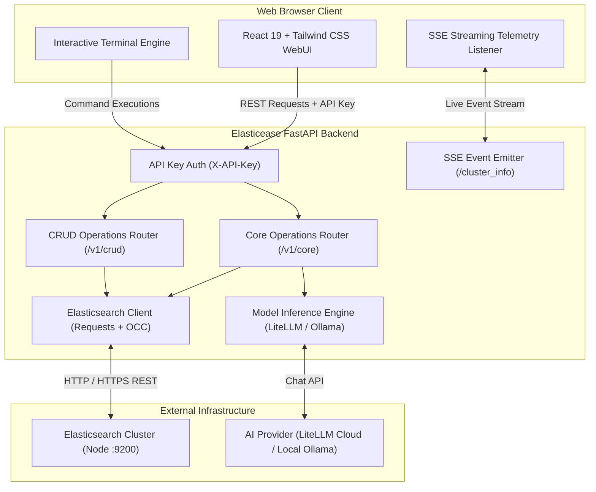

<div align="center">


# ⚡ Elasticease Web

### *Making Elasticsearch Much Easier, Smarter, and Visual.*

[](https://www.python.org/)
[](https://fastapi.tiangolo.com/)
[](https://react.dev/)
[](https://vitejs.dev/)
[](https://tailwindcss.com/)
[](https://www.docker.com/)
[](./LICENSE)

<p align="center">
  A next-generation web console and management platform for <b>Elasticsearch</b>.<br/>
  Featuring real-time cluster telemetry, an interactive command-line terminal, complete document CRUD with Optimistic Concurrency Control, high-throughput bulk operations, and <b>AI-powered operational insights</b> powered by <b>LiteLLM</b> and <b>Ollama</b>.
</p>

[**Explore Commands**](./COMMANDS.md) • [**Backend API Docs**](./backend/README.md) • [**Contribution Guide**](./CONTRIBUTING.md) • [**License**](./LICENSE) • [**Report Bug**](https://github.com/Pulsedude/elasticease-web/issues)

</div>

---

## 📑 Quick Navigation

- [⚡ Elasticease Web](#-elasticease-web)
    - [*Making Elasticsearch Much Easier, Smarter, and Visual.*](#making-elasticsearch-much-easier-smarter-and-visual)
  - [📑 Quick Navigation](#-quick-navigation)
  - [🎥 Video Demo](#-video-demo)
  - [✨ Key Features](#-key-features)
  - [🏗 System Architecture](#-system-architecture)
  - [💻 Technology Stack](#-technology-stack)
  - [🚀 Quickstart \& Installation](#-quickstart--installation)
    - [Prerequisites](#prerequisites)
    - [Method 1: Local Development (Automated Script)](#method-1-local-development-automated-script)
    - [Method 2: Docker \& Container Deployment](#method-2-docker--container-deployment)
      - [Option A: Quickstart with Docker Compose](#option-a-quickstart-with-docker-compose)
      - [Option B: Building Docker Images from Source](#option-b-building-docker-images-from-source)
        - [1. Build the Backend Image](#1-build-the-backend-image)
        - [2. Build the Frontend Image](#2-build-the-frontend-image)
        - [3. Or Build with Docker Compose](#3-or-build-with-docker-compose)
      - [Option C: Running Containers Independently with Volume Mounts (`-v`)](#option-c-running-containers-independently-with-volume-mounts--v)
        - [1. Start the Elasticsearch Container](#1-start-the-elasticsearch-container)
        - [2. Run the Backend Container Independently](#2-run-the-backend-container-independently)
        - [3. Run the Frontend Container Independently](#3-run-the-frontend-container-independently)
    - [Method 3: Manual Execution (Local Terminals)](#method-3-manual-execution-local-terminals)
  - [⚙️ Configuration Guide](#️-configuration-guide)
    - [Environment Variables (`.env`)](#environment-variables-env)
    - [Application Configuration (`config.yaml`)](#application-configuration-configyaml)
  - [🖥 Interactive Web Terminal](#-interactive-web-terminal)
    - [Quick Commands Cheat Sheet](#quick-commands-cheat-sheet)
  - [🔌 Backend REST \& SSE API Reference](#-backend-rest--sse-api-reference)
    - [Authentication \& Security (`X-API-Key`)](#authentication--security-x-api-key)
    - [Core Operations Routes (`/v1/core`)](#core-operations-routes-v1core)
    - [CRUD \& Bulk Routes (`/v1/crud`)](#crud--bulk-routes-v1crud)
    - [Optimistic Concurrency Control (OCC)](#optimistic-concurrency-control-occ)
    - [Performance Logging \& Profiling](#performance-logging--profiling)
    - [Dedicated Backend Manual (`backend/README.md`)](#dedicated-backend-manual-backendreadmemd)
  - [📚 Documentation \& Further Reading](#-documentation--further-reading)
  - [📄 License \& Authors](#-license--authors)

---

## 🎥 Video Demo

Watch **Elasticease Web** in action — exploring cluster health, executing commands in the interactive console terminal, managing indices, and analyzing cluster telemetry with integrated AI summarization:


> [!NOTE]
> If your browser or markdown viewer does not render the video above, you can access and play the included demo file directly:
> 
> 🔗 **[Click here to watch or download demo.mp4](./demo.mp4)**

<video src="./demo.mp4" controls="controls" width="100%" poster="./webui/src/assets/login_bg_banner.png">
  Your browser does not support the video tag. You can view the demo video directly by clicking <a href="./demo.mp4">demo.mp4</a>.
</video>

---

## ✨ Key Features

- **💻 Interactive Command Terminal**:
  - Full-featured web console with shell-like syntax, parameter autocompletion (`Tab`), history navigation (`↑`/`↓`), command suggestions, and real-time parameter hints.
  - Supports formatted tabular output, colorized JSON rendering, and raw exports.

- **🤖 AI-Powered Diagnostic Summarization**:
  - Summarizes complex cluster telemetry, shard distributions, node resource pressures, and storage allocation into concise, actionable English.
  - Multi-provider AI inference support: Cloud models via **LiteLLM** (Google Gemini, OpenAI, Claude) or local, privacy-first models via **Ollama**.
  - Toggle AI mode globally or on a per-command basis using the `ai_summarization=true` flag.

- **📡 Real-Time SSE (Server-Sent Events) Telemetry**:
  - Automatic 10-second background heartbeat and live metrics streaming (`/_cluster/stats`) over SSE with custom authentication headers.
  - Live visual status indicators in the navbar and interactive health charts.

- **🛡️ Full Document CRUD with Optimistic Concurrency Control (OCC)**:
  - Create, view, update, and delete individual documents.
  - Automatically fetches `_seq_no` and `_primary_term` to prevent accidental overwrites and enforce concurrency integrity.

- **📦 High-Performance Bulk Processing**:
  - Insert, update, or delete thousands of documents simultaneously using NDJSON batch streaming via file uploads.

- **🗂️ Comprehensive Index Management**:
  - Create indices with custom schema mappings, inspect shard allocations, track segment counts, analyze aliases, and flush or refresh indices on demand.

- **🔒 Security & API Key Authentication**:
  - Constant-time secret token verification (`X-API-Key`) protecting all backend routes and streaming endpoints.
  - Session boot ID tracking to ensure safe multi-tab frontend access.

- **🌗 Modern Responsive UI (Tailwind CSS 4)**:
  - High-performance, pixel-crafted UI featuring both **Dark** and **Light** themes with instant local storage persistence.

---

## 🏗 System Architecture

Elasticease Web couples an asynchronous Python backend with a reactive frontend and AI inference engine:



---

## 💻 Technology Stack

| Layer | Technologies |
| :--- | :--- |
| **Frontend** | React 19, Vite 8, Tailwind CSS 4, React Router 7, Lucide Icons, React Markdown |
| **Backend** | Python 3.13+, FastAPI, Uvicorn, Pydantic 2, Requests, PyYAML, Rich, psutil |
| **AI Inference** | LiteLLM (Google Gemini, OpenAI, Anthropic), Ollama (Local LLMs) |
| **Database** | Elasticsearch 8.x / 9.x (Wolfi container or bare metal) |
| **DevOps & Containers** | Docker, Docker Compose, Alpine Linux multi-stage images |

---

## 🚀 Quickstart & Installation

### Prerequisites

- **Python 3.13+** installed on your system.
- **Node.js 18+** and **npm** installed.
- A running **Elasticsearch** instance (v8.x or v9.x).

---

### Method 1: Local Development (Automated Script)

The easiest way to get started is using the unified `run.py` launcher script:

1. **Clone the repository**:
   ```bash
   git clone https://github.com/Pulsedude/elasticease-web.git
   cd elasticease-web
   ```

2. **Configure your environment**:
   ```bash
   # Copy environment and configuration templates
   cp .example.env .env
   cp example.config.yml config.yaml
   ```
   *Edit `.env` to define your `BACKEND_API_KEY` and update `config.yaml` with your Elasticsearch credentials.*

3. **Install Python dependencies**:
   ```bash
   python -m venv .venv
   # Windows PowerShell:
   .venv\Scripts\Activate.ps1
   # Linux / macOS:
   source .venv/bin/activate

   pip install -r requirements.txt
   ```

4. **Install Frontend dependencies**:
   ```bash
   cd webui
   npm install
   cd ..
   ```

5. **Launch Elasticease Web**:
   ```bash
   python run.py
   ```
   *Both frontend and backend will start concurrently, and your default browser will open automatically to `http://localhost:5173/login`.*

---

### Method 2: Docker & Container Deployment

Elasticease Web provides full Docker container support for both unified multi-service orchestration and isolated standalone container execution.

#### Option A: Quickstart with Docker Compose

Deploy the entire stack (Frontend, Backend, and Elasticsearch Wolfi) with a single command using pre-configured public images:

```bash
docker compose up -d
```

- **Frontend Web UI**: `http://localhost:5173`
- **FastAPI Backend API**: `http://localhost:8000` (or configured port)
- **Elasticsearch**: `http://localhost:9200`
- **View Stack Logs**: `docker compose logs -f`
- **Stop All Services**: `docker compose down`

---

#### Option B: Building Docker Images from Source

If you made modifications or wish to build your own custom container images locally rather than pulling from Docker Hub, use the provided Dockerfiles:

##### 1. Build the Backend Image
The backend image uses an optimized Alpine Linux base with Python 3, virtual environment isolation, and all FastAPI dependencies:
```bash
docker build -t elasticease-backend -f Dockerfile.backend .
```

##### 2. Build the Frontend Image
The frontend image bundles Node.js, Vite, React 19, and Tailwind CSS:
```bash
docker build -t elasticease-frontend -f Dockerfile.frontend .
```

##### 3. Or Build with Docker Compose
Uncomment the `build:` directives in `docker-compose.yml` and run:
```bash
docker compose build
docker compose up -d
```

---

#### Option C: Running Containers Independently with Volume Mounts (`-v`)

When running the backend and frontend containers independently using `docker run`, **it is essential to mount `config.yaml` and `.env` using the `-v` flag**.

> [!IMPORTANT]
> ### ⚠️ Why Volume Mounting `-v` is Mandatory:
> 1. **Mounting `config.yaml` (`-v <host_path>/config.yaml:/elasticease/config.yaml`)**:
>    - The backend and frontend need to read your Elasticsearch connection URL, cluster credentials (`username`/`password`), CORS origins, and AI provider keys.
>    - When you update endpoints or AI settings from the web interface, the backend writes these changes directly back to `config.yaml`. Mounting this file ensures host-container synchronization and persists settings across container restarts without needing image rebuilds.
> 2. **Mounting `.env` (`-v <host_path>/.env:/elasticease/.env`) & `--env-file .env`**:
>    - The backend verifies every API request using `X-API-Key` matching `BACKEND_API_KEY` defined in `.env`.
>    - Mounting `.env` guarantees that security tokens are loaded by the container environment.

##### 1. Start the Elasticsearch Container
```bash
docker run -d \
  --name elastic \
  --network host \
  docker.elastic.co/elasticsearch/elasticsearch-wolfi:9.5.6
```

##### 2. Run the Backend Container Independently

**Linux / macOS (bash / zsh)**:
```bash
docker run -d \
  --name elasticease_backend \
  --network host \
  --env-file .env \
  -v "$(pwd)/config.yaml:/elasticease/config.yaml" \
  -v "$(pwd)/.env:/elasticease/.env" \
  raunaksharma/elasticease-api:latest
```

**Windows (PowerShell)**:
```powershell
docker run -d `
  --name elasticease_backend `
  --network host `
  --env-file .env `
  -v "${PWD}/config.yaml:/elasticease/config.yaml" `
  -v "${PWD}/.env:/elasticease/.env" `
  raunaksharma/elasticease-api:latest
```

##### 3. Run the Frontend Container Independently

**Linux / macOS (bash / zsh)**:
```bash
docker run -d \
  --name elasticease_frontend \
  --network host \
  --env-file .env \
  -v "$(pwd)/config.yaml:/elasticease/config.yaml" \
  -v "$(pwd)/.env:/elasticease/.env" \
  raunaksharma/elasticease-webui:latest
```

**Windows (PowerShell)**:
```powershell
docker run -d `
  --name elasticease_frontend `
  --network host `
  --env-file .env `
  -v "${PWD}/config.yaml:/elasticease/config.yaml" `
  -v "${PWD}/.env:/elasticease/.env" `
  raunaksharma/elasticease-webui:latest
```

---

### Method 3: Manual Execution (Local Terminals)

If you wish to run backend and frontend in separate terminals:

**Terminal 1 — Backend**:
```bash
cd backend
python main.py
```

**Terminal 2 — Frontend**:
```bash
cd webui
npm run dev
```

---

## ⚙️ Configuration Guide

### Environment Variables (`.env`)

Create a `.env` file in the root directory:

```ini
# Secret API Key required for all requests from WebUI to the Python backend
BACKEND_API_KEY=your-secure-backend-api-key-here
```

### Application Configuration (`config.yaml`)

Elasticease uses `config.yaml` as the centralized source of truth for runtime settings:

```yaml
elasticease_web:
  # Enable or disable AI-powered diagnostic summarization globally
  ai_mode: true

  # Select default inference engine: 'litellm' or 'ollama'
  selected_ai_inference: litellm

  # FastAPI Backend settings
  backend:
    host: 0.0.0.0
    port: 8000
    base_url: http://localhost:8000
    allow_origins:
      - http://localhost:5173
      - http://127.0.0.1:5173

  # Elasticsearch cluster connection settings
  elasticsearch:
    base_url: https://localhost:9200
    username: elastic
    password: your_elastic_cluster_password
    verify_certs: false

  # React Vite Frontend settings
  frontend:
    host: 0.0.0.0
    port: 5173

  # AI Model Provider settings
  model_providers:
    litellm:
      api_key: your_gemini_or_openai_api_key
      model: gemini/gemini-3-flash-preview
    ollama:
      base_url: http://0.0.0.0:11434
      model: gpt-oss:120b-cloud
```

> [!TIP]
> You can also update backend and Elasticsearch endpoints on the fly without restarting servers directly from the **Settings Page** in the web interface.

---

## 🖥 Interactive Web Terminal

Elasticease Web includes a command terminal inspired by modern developer consoles:

```text
elasticease> cluster:health
Status: green | Total Nodes: 3 | Active Shards: 284 | Unassigned: 0

elasticease> index:list ai_summarization=true
[AI Analysis]: Your cluster currently maintains 12 indices. All primary and replica
shards are healthy and evenly distributed across 3 nodes with zero unassigned shards.
```

### Quick Commands Cheat Sheet

| Command | Action | Example |
| :--- | :--- | :--- |
| `cluster:health` | Check cluster health status | `cluster:health json=false` |
| `cluster:stats` | View comprehensive stats | `cluster:stats` |
| `index:list` | List all indices | `index:list ai_summarization=true` |
| `index:inspect` | Inspect schema mapping or stats | `index:inspect customers mapping` |
| `index:create` | Create a new index | `index:create orders with_mapping=true` |
| `index:delete` | Drop an existing index | `index:delete staging_logs confirm=true` |
| `document:get` | Inspect document by ID | `document:get customers cust_101` |
| `document:insert` | Insert document with editor | `document:insert customers` |
| `document:update` | Update document with OCC | `document:update customers cust_101` |
| `document:delete` | Delete document by ID | `document:delete customers cust_101` |
| `bulk:insert` | Bulk insert from JSON file | `bulk:insert products ./batch.json` |
| `shards:list` | View active and unassigned shards | `shards:list unassigned=true` |
| `node:stats` | View node memory, JVM, and CPU | `node:stats node-1 metric=jvm` |

👉 **For full syntax, arguments, allowed values, and examples for all 30+ commands, see the [COMMANDS.md Reference Manual](./COMMANDS.md).**

---

## 🔌 Backend REST & SSE API Reference

The backend exposes a modern, asynchronous API built with **FastAPI**. Live interactive OpenAPI documentation is accessible at:
```text
http://localhost:8000/docs  (Swagger UI)
http://localhost:8000/redoc (ReDoc)
```

### Authentication & Security (`X-API-Key`)
Every API request (except `/docs` and the root redirect) must include the `X-API-Key` HTTP header. Missing or invalid keys result in an immediate `403 Forbidden` response.

```http
GET /v1/core/cluster_inspect?info_type=health HTTP/1.1
Host: localhost:8000
X-API-Key: your_backend_api_key
```

---

### Core Operations Routes (`/v1/core`)

| Method | Endpoint | Description | Key Parameters / Payload |
| :--- | :--- | :--- | :--- |
| `GET` | `/v1/core/cluster_info` | **SSE Stream**: Emits live cluster stats every 10s | Headers: `Accept: text/event-stream` |
| `POST` | `/v1/core/auth` | Validates credentials against Elasticsearch | Body: `{"username": "...", "password": "..."}` |
| `GET` | `/v1/core/cluster_inspect` | Query health, stats, settings, or state | Query: `info_type=health\|stats\|settings\|state` |
| `GET` | `/v1/core/shards` | Lists active shards across nodes | Query: `unassigned=bool`, `ai_summarization=bool` |
| `GET` | `/v1/core/nodes` | Lists connected Elasticsearch nodes | Query: `ai_summarization=bool` |
| `GET` | `/v1/core/inspect_node` | Deep node inspection (OS, JVM, Ingest, etc.) | Query: `info_type`, `id_or_name`, `ai_summarization` |
| `GET` | `/v1/core/indices` | Lists all indices with doc counts & storage | Query: `ai_summarization=bool` |
| `GET` | `/v1/core/ai_config` | Returns active AI provider settings | None |
| `PUT` | `/v1/core/ai_inference` | Switches AI engine (`litellm` / `ollama`) | Body: `{"provider": "...", "ai_mode": bool}` |
| `PUT` | `/v1/core/update_elastic_url`| Dynamically updates Elasticsearch base URL | Body: `{"base_url": "https://..."}` |
| `PUT` | `/v1/core/update_backend_url`| Dynamically updates backend base URL | Body: `{"base_url": "http://..."}` |
| `POST`| `/v1/core/ai_summarization` | Sends custom prompts to the AI provider | Body: `{"prompt": "..."}` |
| `POST`| `/v1/core/index_inspect` | Inspects mapping, settings, or stats of an index | Body: `{"name": "...", "info_type": "mapping"}` |
| `GET` | `/v1/core/master_node` | Retrieves elected master node metadata | None |
| `POST`| `/v1/core/allocation` | Inspects disk usage & shard allocation per node | Query: `ai_summarization=bool` |

---

### CRUD & Bulk Routes (`/v1/crud`)

| Method | Endpoint | Description | Key Parameters / Payload |
| :--- | :--- | :--- | :--- |
| `PUT` | `/v1/crud/create_index` | Creates a new index with optional schema | Body: `{"index_name": "...", "with_mapping": bool, "mapping": {...}}` |
| `DELETE` | `/v1/crud/delete_index` | Deletes an existing index | Query: `name=target_index` |
| `POST` | `/v1/crud/insert_doc` | Inserts a new document | Body: `{"index_name": "...", "document_id": "...", "document": {...}}` |
| `POST` | `/v1/crud/index_data_inspect` | Retrieves stored documents from an index | Body: `{"index_name": "...", "size": "100"}` |
| `GET` | `/v1/crud/doc_inspect` | Retrieves a single document by ID | Query: `index_name=...`, `doc_id=...` |
| `POST` | `/v1/crud/update_doc` | Updates a document using OCC verification | Body: `{"index_name": "...", "document_id": "...", "document": {...}}` |
| `DELETE` | `/v1/crud/delete_doc` | Deletes a single document | Query: `index_name=...`, `document_id=...` |
| `POST` | `/v1/crud/bulk_insert` | Bulk inserts documents via file upload | Query: `index_name=...`, Form: `file: UploadFile (.json)` |
| `POST` | `/v1/crud/bulk_update` | Bulk updates documents via file upload | Query: `index_name=...`, Form: `file: UploadFile (.json)` |
| `POST` | `/v1/crud/bulk_delete` | Bulk deletes documents via file upload | Query: `index_name=...`, Form: `file: UploadFile (.json)` |

---

### Optimistic Concurrency Control (OCC)
In `/v1/crud/update_doc`, Elasticease automatically retrieves the document's sequence number (`_seq_no`) and primary term (`_primary_term`) before submitting update mutations. If another process modified the document in between, Elasticsearch detects the version mismatch and rejects the update with a version conflict exception, ensuring data consistency across distributed environments.

---

### Performance Logging & Profiling
Every incoming request is measured with high-precision timestamps (`time.perf_counter()`) and host CPU load (`psutil.cpu_percent()`). Telemetry is logged to `log/api.log`:
```text
INFO: path: /v1/core/shards, method: GET, status: 200, time: 12.304 ms, cpu usage: 4.8 %
```

---

### Dedicated Backend Manual (`backend/README.md`)
For complete request/response schemas, Python implementation details, and step-by-step developer setup instructions, refer to:
👉 **[Read the Full Backend API Documentation (backend/README.md)](./backend/README.md)**

---

## 📚 Documentation & Further Reading

- 🛠️ **[Backend API Documentation (backend/README.md)](./backend/README.md)**: In-depth technical guide for all backend routers, models, SSE streaming, and security.
- 📖 **[Command Reference Manual (COMMANDS.md)](./COMMANDS.md)**: Exhaustive documentation for all CLI commands, arguments, types, and practical examples.
- 🤝 **[Contributing Guidelines (CONTRIBUTING.md)](./CONTRIBUTING.md)**: Guidelines for contributing code, adding new commands, coding standards, and submitting pull requests.
- ⚖️ **[MIT License (LICENSE)](./LICENSE)**: Terms of distribution, modification, and usage.

---

## 📄 License & Authors

This project is licensed under the **MIT License** — see the [LICENSE](./LICENSE) file for complete details.

Created and maintained with ❤️ by **[Raunak Sharma (Pulsedude)](https://github.com/Pulsedude)**.

If you find Elasticease Web helpful, please consider starring ⭐ the repository!
